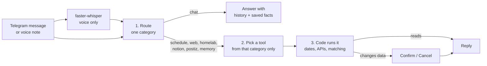

<p align="center">
  
</p>

<h1 align="center">Nhako Bot</h1>

A private Telegram assistant that runs entirely on your own hardware. A small local LLM (via Ollama) understands English and Malay. Local speech-to-text handles voice notes, and a SQLite file holds its memory. Nothing is sent to a hosted AI provider.


---

## Features

| | What you can say | Notes |
|---|---|---|
| 📅 **Calendar** | "what do I have tomorrow?", "add dentist next tuesday 3pm", "move the dentist to 5pm", "remove the dentist thing" | Google Calendar. Moves and deletes always show **Confirm / Cancel** first. Vague names ask *which one* when several match |
| ⏰ **Reminders** | "remind me in 20 minutes to take the laundry out", "ingatkan saya esok 9 pagi" | Sent by the bot on Telegram. Survive restarts; anything missed while offline arrives marked *late* |
| ☀️ **Morning agenda** | — | Today's events, plus Notion tasks that are overdue, due today, due in the next 3 days or in progress, every morning at `AGENDA_TIME` |
| 📊 **Weekly review** | — | Tasks cleared, XP and level, projects and what's overdue, at `WEEKLY_REVIEW` (Sunday 20:00) |
| ⏰ **Overdue nudges** | — | Once a day at `OVERDUE_NUDGE_TIME`, tasks that just went overdue (each one only once) |
| 🌐 **Web** | "search for Paper 1.21 release notes", paste any link | DuckDuckGo plus page reading, summarised with source links. Local-network addresses are refused |
| 🎮 **Minecraft** | "who's on getgud?" | Player names and counts from a server-list ping |
| 🐳 **Docker** | "is nextcloud healthy?", "how are my stacks?" | Per-stack health through a read-only, allowlisted socket proxy |
| 📝 **Notion tasks** | "add renew passport to my tasks by friday", "what's due this week?", "I finished the invoice", "move the landing page task to in progress", "remove the thumbnail task" | Every change asks first; removing moves the page to Notion's trash |
| ✏️ **Task edits** | "push the bug fixes quest to friday", "make it a boss quest", "rename the thumbnail quest to File previews", "update bug fixes: half done" | A note also goes into the page body as a dated log; finished tasks can be reopened |
| 🗺️ **Notion projects** | "how far along are my projects?", "what's left in Octomations?", "set Nhako Beam progress to 50%", "pause NeraOS", "start a new project called Nhako Radio" | Needs a relation from the tasks database to a projects database |
| 🏆 **XP & pages** | "how much XP this week?", "what's my level?", "what's in my Nhako Depot page?" | XP comes from the database's own XP formula; pages are only those shared with the integration |
| 📣 **Postiz** | "what's going out on social media this week?", "draft a tweet about the server wipe" | Saved as a **draft** after you confirm. The bot never publishes |
| 🧠 **Memory** | "remember that I'm allergic to prawns", "what do you know about me?" | Only saved when you ask. Passwords, PINs, keys and IC/card numbers are refused |
| 🚨 **Alerts** | — | A message when a container crashes or turns unhealthy, a Minecraft server stops answering or Ollama goes down, and again when it recovers |
| 🎙️ **Voice notes** | any of the above, spoken | Transcribed offline with faster-whisper on the CPU |

### Commands

Commands answer instantly and never touch the model, so they work even while Ollama is loading or down.

| Command | Does |
|---|---|
| `/today [tomorrow, this week, friday…]` | Calendar for a day or range |
| `/tasks [today, this week, overdue, in progress]` | Open Notion tasks |
| `/projects [all]` | Notion projects and their progress |
| `/stats [this week, this month, all time]` | Tasks cleared, XP and level |
| `/reminders` | Upcoming reminders, tap one to cancel it |
| `/mc [server]` | Who's online on the Minecraft servers |
| `/docker [name]` | Container and stack health |
| `/memory` | What the bot remembers, tap one to forget it |
| `/ping` | Checks the model, Google, Notion and Postiz |
| `/help` | Everything above |

The bot registers these with Telegram at startup, so they show up in the `/` menu.

---

## How it works



1. **Route.** One short model call picks a category, guided by few-shot examples of the borderline cases.
2. **Pick a tool.** The model sees only that category's 2–5 tools and copies the details out of your message in your own words ("next tuesday 3pm").
3. **Run.** Code does the real work: date maths ([nhako/timeparse.py](nhako/timeparse.py)), fuzzy matching and API calls. Anything that changes or deletes data returns a confirmation instead of acting.

A 2B model stays accurate this way: it chooses from a handful of tools and never does date arithmetic.

### Layout

```
nhako/
  __main__.py      python -m nhako
  bot.py           Telegram: auth, commands, typing indicator, confirm buttons
  agent.py         route -> tool call -> run -> reply
  router.py        category classification (JSON-schema output)
  llm.py           async Ollama client (timeout, keep-alive, one call at a time)
  timeparse.py     "esok 3 petang" -> datetime
  store.py         SQLite: history, pending confirmations, reminders, facts
  scheduler.py     reminders, morning agenda, daily cleanup, heartbeat
  monitor.py       homelab + Ollama alerts (changes only)
  speech.py        faster-whisper, loaded on the first voice note
  config.py        every setting, from .env
  tools/           one module per integration
scripts/
  bench.py         model benchmark: routing, tool choice, arguments, speed
  google_auth.py   one-time Google consent -> data/token.json
tests/             unit tests (fake model/APIs) + live tests against Ollama
docs/
  REVIVAL_PLAN.md  hardware notes, roadmap and the reasons behind each choice
```

---

## Setup

### 1. Ollama, on the host with the GPU

```bash
winget install --id Ollama.Ollama --exact
ollama pull qwen3.5:2b
```

On Pascal cards (GTX 10xx), check that `%LOCALAPPDATA%\Ollama\server.log` has an `inference compute ... library=CUDA` line. Ollama's CUDA 13 build dropped these cards, and only the CUDA 12 build still supports them, so **don't auto-update Ollama blindly**.

### 2. Create the bot in Telegram

1. Message [@BotFather](https://t.me/botfather), send `/newbot` and pick a name. Copy the token.
2. Get your numeric user id from [@userinfobot](https://t.me/userinfobot).
3. Optional, in BotFather → `/mybots` → your bot → **Edit Bot**:
   - **Edit Botpic**: the profile picture. Send a square JPG or PNG (512×512 or larger).
   - **Edit Description**: the text on the empty-chat screen, e.g. "Hakim's private assistant. Runs on a home server."
   - **Edit About**: the one-line bio on the bot's profile.
   - **Bot Settings → Allow Groups → Turn off**: the bot only ever answers you anyway.

### 3. Configure

```bash
cp .env.example .env
```

Set `TELEGRAM_TOKEN` and `ALLOWED_USER_ID`. Everyone else is ignored and logged. Everything else is optional; see [Configuration](#configuration).

### 4. Integrations (all optional)

- **Google Calendar.** Create a *Desktop app* OAuth client in Google Cloud and save it as `data/credentials.json`. Then run this once on a machine with a browser:
  ```bash
  python scripts/google_auth.py
  ```
  It writes `data/token.json`, and the bot refreshes the token itself from then on.
- **Notion.** Create an internal integration at notion.so/profile/integrations and put its secret in `NOTION_TOKEN`. Put your tasks database's URL in `NOTION_TASKS_DB`. On the database page, open ••• → Connections and add the integration. Any database with a title, a date and a status or checkbox column works. If it has a relation to a projects database (like Quests → Campaigns), the bot follows it: it can list projects, add tasks to one, and write a percentage into the projects database's number column (e.g. `Manual %`) to set progress.
- **Postiz.** Put the API key from Postiz → Settings → Public API in `POSTIZ_API_KEY`, and your backend URL (ending in `/api`) in `POSTIZ_URL`.

### 5. Run

**Docker (recommended):**

```bash
docker compose up -d --build
docker compose logs -f
```

The container reaches Ollama at `host.docker.internal:11434`. It's capped at 512 MB (it peaks at ~430 MiB with whisper loaded) and is the first thing the kernel kills if memory runs out. `docker ps` shows it as *healthy* while the scheduler loop is alive.

**Locally:**

```bash
python -m venv .venv
.venv/Scripts/activate            # Linux/macOS: source .venv/bin/activate
pip install -r requirements-dev.txt
python -m nhako
```

---

## Configuration

All settings come from `.env` (see [.env.example](.env.example)). Inside Docker, `compose.yaml` sets `OLLAMA_HOST`, `DOCKER_PROXY_URL` and `MC_SERVERS`.

| Variable | Default | Meaning |
|---|---|---|
| `TELEGRAM_TOKEN` | — | **Required.** From @BotFather |
| `ALLOWED_USER_ID` | — | **Required.** The only Telegram user the bot answers |
| `OLLAMA_HOST` | `http://127.0.0.1:11434` | Ollama server |
| `OLLAMA_MODEL` | `qwen3.5:2b` | Model name; must be pulled |
| `OLLAMA_NUM_CTX` | `4096` | Context window in tokens |
| `OLLAMA_TIMEOUT` | `120` | Seconds before a model call is given up |
| `OLLAMA_KEEP_ALIVE` | `30m` | How long the model stays in VRAM after a message |
| `TIMEZONE` | `Asia/Kuala_Lumpur` | IANA timezone for all dates |
| `AGENDA_TIME` | `08:00` | Morning agenda time (24h), or `off` |
| `WEEKLY_REVIEW` | `sun 20:00` | Weekly Notion review, day and time, or `off` |
| `OVERDUE_NUDGE_TIME` | `18:00` | Daily overdue-task ping (24h), or `off` |
| `MC_SERVERS` | `getgud=127.0.0.1:25565` | `name=host:port`, comma-separated |
| `MC_ALERT_SERVERS` | `getgud` | Servers that alert when they stop answering |
| `DOCKER_PROXY_URL` | *(empty)* | Read-only Docker socket proxy; empty disables `/docker` |
| `ALERTS` | `true` | Push homelab and Ollama alerts |
| `ALERT_IGNORE` | *(empty)* | Container names never to alert about |
| `NOTION_TOKEN`, `NOTION_TASKS_DB` | *(empty)* | Notion integration secret and tasks database |
| `POSTIZ_URL`, `POSTIZ_API_KEY` | *(empty)* | Postiz backend URL and public API key |
| `GOOGLE_CREDENTIALS_FILE`, `GOOGLE_TOKEN_FILE` | `credentials.json`, `token.json` | File names inside `DATA_DIR` |
| `WHISPER_MODEL` | `base` | `tiny`, `base` or `small` |
| `HISTORY_TURNS` | `6` | Recent messages given to the model as context |
| `HISTORY_KEEP` | `200` | Messages kept per chat; older ones are deleted daily |
| `DATA_DIR` | `data` | Database, Google token and whisper cache |

A malformed `AGENDA_TIME` or `TIMEZONE` stops the bot at startup with a clear error, instead of failing later.

---

## Security model

- **One user.** Every handler, including button presses, checks `ALLOWED_USER_ID`.
- **Nothing changes without a tap.** Moving or deleting events, completing tasks, forgetting facts and saving Postiz drafts all show Confirm / Cancel. A confirmation expires after 30 minutes and works only once.
- **The web is data, not instructions.** Page text is labelled untrusted, and the model call that summarises it gets no tools, so a malicious page can't trigger an action. `read_url` refuses private, loopback and link-local addresses on every redirect hop.
- **Docker is read-only and allowlisted.** The bot reaches Docker only through [wollomatic/socket-proxy](https://github.com/wollomatic/socket-proxy), which allows exactly `GET /containers/json` and `GET /containers/{id}/stats`, and only from the bot's container. Logs, file archives, inspect, images and any POST are refused.
- **Hardened containers.** Read-only root filesystem, all Linux capabilities dropped, `no-new-privileges`, non-root users, images pinned by digest, and memory limits that sacrifice the bot before any game server.
- **Postiz drafts only.** The API key is organisation-wide, so the bot only lists posts and creates drafts. It never schedules or deletes.
- **Secrets stay out.** `.env`, `data/` and the Google files are git- and docker-ignored. Memory refuses to store passwords, PINs, keys and ID or card numbers. Old messages are pruned daily.

---

## Hardware and tuning

Built for a Ryzen 5 5500 with a **GTX 1050 Ti (4 GB)**, where the desktop already takes about 1.8 GB of VRAM. The full reasoning is in [docs/REVIVAL_PLAN.md](docs/REVIVAL_PLAN.md).

- `qwen3.5:2b` won the benchmark: 93% routing, 100% tool choice, 3.2 s median. Re-run it after any model change:
  ```bash
  python scripts/bench.py
  ```
- **Fit the whole model on the GPU.** The default `qwen3.5:2b` tag is Q8_0 (2.7 GB with its vision projector), so part of it spills to the CPU. A Q4_K_M build of the same model is about half the size. Benchmark it, and switch `OLLAMA_MODEL` only if routing stays at 90% or above.
- **Shrink the KV cache.** Set these Windows user environment variables, then restart Ollama:
  ```
  OLLAMA_FLASH_ATTENTION=1
  OLLAMA_KV_CACHE_TYPE=q8_0
  ```
  Benchmark before and after; flash attention on Pascal cards varies.
- **Cold starts.** The bot pre-warms the model at startup and 5 minutes before the morning agenda, and keeps it loaded for `OLLAMA_KEEP_ALIVE` after each message.

---

## Troubleshooting

| Symptom | Check |
|---|---|
| "My local brain didn't answer" | `/ping`. Then `ollama ps`, and `server.log` for the CUDA line |
| First reply after a long idle is slow | Normal: a cold model load takes 10–60 s. Raise `OLLAMA_KEEP_ALIVE` to keep it loaded |
| Calendar says it isn't set up | Run `python scripts/google_auth.py` and check that `data/token.json` exists |
| Notion "refused that" | Share the database with the integration (••• → Connections) |
| `/docker` can't reach Docker | `docker compose ps`: is `nhako-docker-proxy` running? |
| Container shows *unhealthy* | `docker compose logs nhako`: the scheduler loop stopped writing its heartbeat |

---

## Development

```bash
pytest -m "not live"     # unit tests: fake model and APIs, a few seconds
pytest -m live           # routing and tool choice against the real local model
ruff check .             # lint
```

---

## License

MIT, see [LICENSE](LICENSE). Built as a homelab project by **kimzam**.
